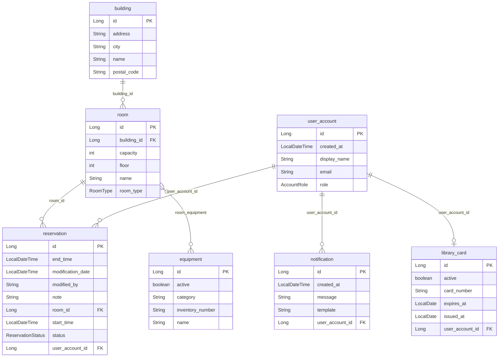

# Schemat bazy danych

Plik generują reguły projektu (panel Maven → Lifecycle → verify). Nie edytujcie go ręcznie.

Tabele: 8 (w tym tabele łączące @ManyToMany: room_equipment) · kolumny: 41 · relacje: 4 × @ManyToOne, 1 × @OneToMany, 1 × @OneToOne, 1 × @ManyToMany

| Tabela | Encja | Kolumny | Klucze obce |
|---|---|---|---|
| building | Building | 5 | — |
| equipment | Equipment | 5 | — |
| library_card | LibraryCard | 6 | user_account_id |
| notification | Notification | 5 | user_account_id |
| reservation | Reservation | 9 | room_id, user_account_id |
| room | Room | 6 | building_id |
| user_account | UserAccount | 5 | — |

